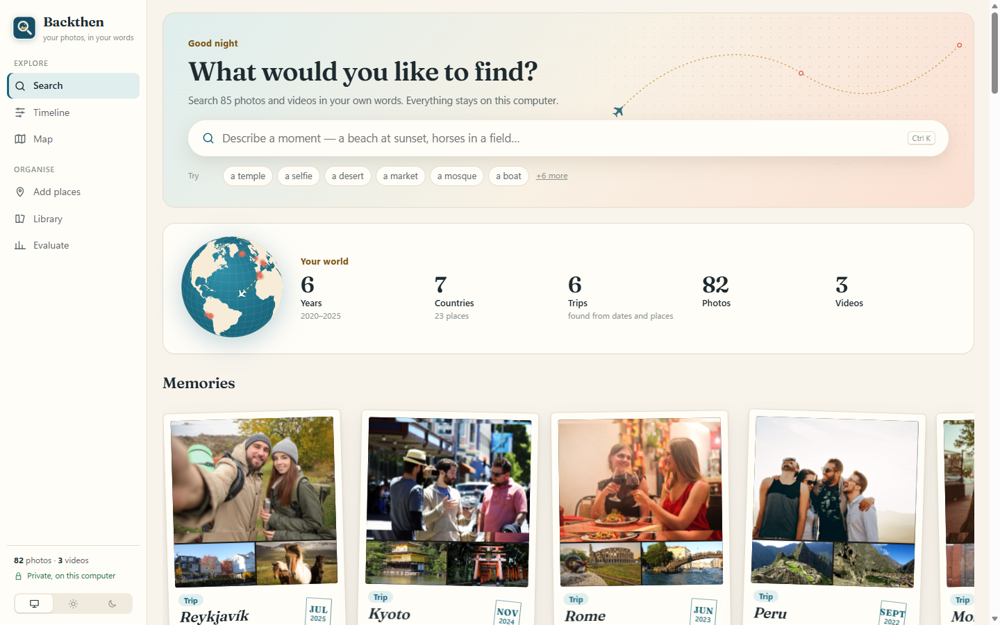
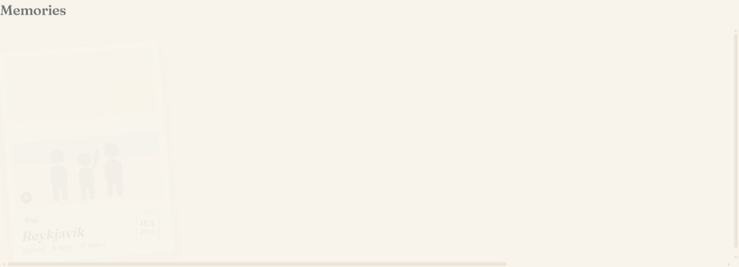
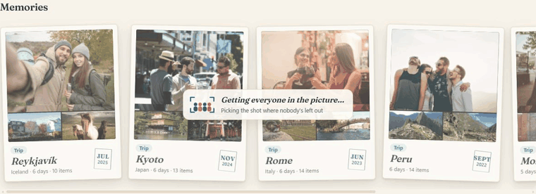
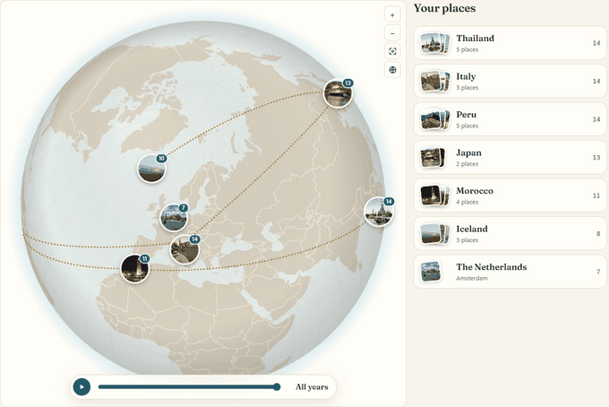
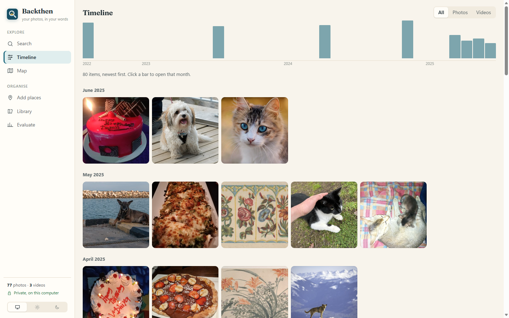
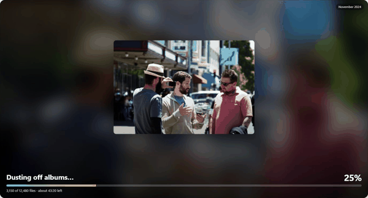
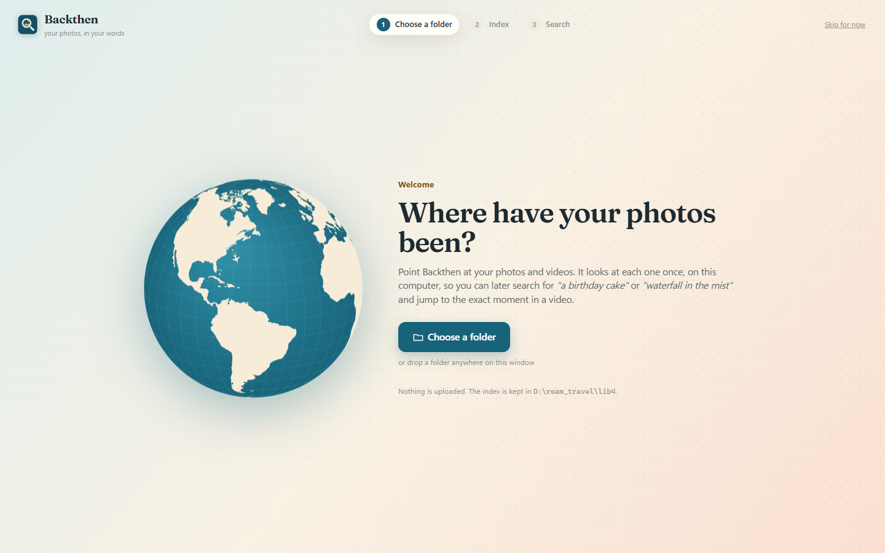
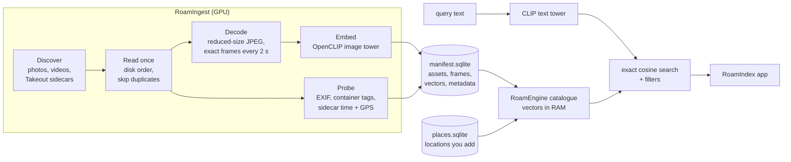

# Backthen

**Find your trips, your people and your moments again, privately, on your own laptop.**

Backthen turns years of photos and videos into the memories you want to go back to. Search in plain words ("friends on a trip", "waterfall in the mist"), jump to the exact second inside a video, and watch your travels light up on a globe. It all runs on your computer: no uploads, no cloud, no account.



## Why we built it

Our phones and hard drives hold years of trips, buried under screenshots, receipts and forty versions of the same sunset. Cloud services can dig the good ones out, but only after scanning your whole life on their servers.

We wanted the remembering without the uploading. We also noticed which photos we actually go back to: hardly ever the prettiest landscape, nearly always the ones with the people we went with, from the few days when we really got away.

So Backthen looks for those. If seeing an old trip makes you message the group and plan the next one, it has done its job.

## Memories worth keeping



A memory here is more than a good-looking photo. These are the rules:

| Rule | Why |
|---|---|
| **A trip is 3 days or more, away from home** | A day or two is a day out. It takes longer than that to escape your routine, and those are the trips that stay with you. |
| **A memory is shared** | One of its best photos must show two or more people, or it doesn't make the row. |
| **Nobody is left out** | The postcard leads with the *whole group*: the largest number of people that repeats across the trip's photos. A single photo full of strangers doesn't count. |
| **Nobody is cropped out** | At least 93% of the big photo's width is always visible, so the friend at the edge stays in. |
| **No day appears twice** | Each day belongs to one memory, and a postcard's photos come from different days. |

Trips come first, then this month in earlier years, then your busiest months. While Backthen is still looking for the photo with everyone in it (a new library, or new photos), it says so and the better cover develops in place:



## Your travels on a globe



- **Replay my travels** flies trip to trip, oldest first, with a postcard at every stop.
- **Pins show the place, not the people:** the photo that best defines each town. Zoomed out, places with 100+ photos show their photo and from 21 a count; zoomed into a region, every place with 21+ shows its photo; fewer is a dot.
- **Your places** lists countries and towns, and a year slider shows where you were over time.
- It works offline. No map tiles are downloaded.


## Search in your own words

| | |
|---|---|
|  **Describe it:** results as you pause typing, recent searches kept on this computer, `Ctrl K` from anywhere. |  **The exact moment in a video:** "friends laughing together" opens the clip at the second where they appear; the strip shows its other best moments. |
|  **Your world:** years, countries, trips, photos and videos, found from dates and GPS alone. Light, dark, or follow Windows. |  **Timeline:** items per month on a continuous axis. |

## From a folder to memories



Point Backthen at a folder or drive. It reads each file once, never changes it, and can be stopped at any time. While it works, the photos it has found fade past with a line of travel nostalgia ("Rewinding the road trip…").

| | |
|---|---|
|  **First run:** choose or drop a folder; the drive type (USB hard drive or SSD) is detected for you. |  **Add places:** give photos without GPS a location by name (offline, 172k places) or by clicking the globe. Originals and their dates are never modified. |

<sub>**About the pictures:** screenshots and animations use a sample library of 82 hand-picked CC0 photos ([credits](docs/screenshots/ATTRIBUTION.md), built by [`bench/demo`](bench/demo)) arranged into six made-up trips. Dates and places are invented, the group photos are stock photos that were not taken at those places, and the three videos are assembled from the photos. The map uses lower pin thresholds because the library is small, and the indexing animation shows sample progress.</sub>

---

*The rest of this page is for the technically curious: how it works, the models and the benchmarks.*

## How it works

Backthen is three pieces:

| Component | What it does | Code |
|---|---|---|
| **RoamIngest** | Reads a large mixed archive once, extracts frames, metadata and CLIP embeddings into a versioned SQLite manifest. Resumable, kill-safe, deterministic. | [`packages/roam-ingest`](packages/roam-ingest) |
| **RoamEngine** | Local search engine and HTTP API: natural-language search, trips, memories, faces, time and place filters, video moments, retrieval evaluation. | [`packages/roam-engine`](packages/roam-engine) |
| **RoamIndex** | The Backthen desktop app (Tauri 2 + React). | [`apps/roamindex`](apps/roamindex) |



1. **Discover** every photo (JPEG, PNG, WebP, HEIC, GIF, Nikon NEF) and video (MP4, MOV, MKV, WebM, 3GP...) plus Google Takeout `.json` sidecars.
2. **Read each file once.** On a hard drive: one sequential reader, files sorted by their physical position on disk, and byte-identical copies recognised from 128 KiB and linked without reading the rest.
3. **Decode** photos at reduced size (enough for the 224 px model input and thumbnails) and videos with *smart* exact sampling: one frame every 2 s (max 32), seeking past keyframe intervals without a target (66% fewer frames decoded, bit-identical output). HEVC goes to the GPU decoder (NVDEC).
4. **Probe** capture time and GPS from EXIF, video container tags and Takeout sidecars, recording where each value came from.
5. **Embed** each photo and frame with an OpenCLIP image encoder (fp16 on CUDA) in fixed-shape batches, so re-running gives bit-identical vectors.
6. **Write** everything to `manifest.sqlite` (schema v1) in per-file transactions: a run can be killed at any moment and resumed; an unchanged rerun does nothing.

**Search:** the query goes through the matching CLIP text encoder; its vector is compared with every photo and frame vector (one matrix-vector product, exact, no approximate index needed at this scale). A video scores by its best frame and returns its best moments with timestamps. Filters (`type:video`, `year:2019`, `after:2020-05`, `has:gps`, near a point) are masks over the scores.

## Embedding model

Default: **OpenCLIP ViT-B/32, LAION-2B** (`laion2b_s34b_b79k`, 512-d). CLIP embeds images and text in one space, so a text query finds images directly, with no captions or tags needed. Every vector records its `model_id`, so libraries built with different models never mix. `roamingest run --model <arch>/<pretrained>` picks another OpenCLIP model that uses 224 px input and CLIP normalisation.

**Public benchmarks, text to image/video, Recall@1** (the right item ranked first), all run through the unchanged pipeline and `Engine.search` ([details](results/EXP_MODEL_COMPARE.md)):

| Model | Flickr30k 1k | MS-COCO 5k | MSR-VTT 1k-A (video) | Query time, CPU / GPU text encoder |
|---|---|---|---|---|
| ViT-B/32 LAION-2B (default) | 0.662 | 0.394 | 0.327 | 32 / 9 ms |
| ViT-B-16 DFN-2B | 0.691 | 0.436 | 0.314 | 32 / 9 ms |
| ViT-L-14 DataComp-XL | 0.733 | 0.459 | 0.359 | 60 / 9 ms |
| ViT-L-14 DFN-2B | 0.751 | 0.487 | 0.368 | 61 / 9 ms |
| **ViT-H-14 DFN-5B** | **0.797** | **0.527** | **0.384** | 228 / 30 ms |

- The pipeline loses nothing: with the default model it matches plain OpenCLIP on the same files and the published OpenCLIP numbers (Flickr R@1 0.662 vs 0.667 plain vs 0.668 published; COCO 0.394 / 0.394 / 0.393) ([details](results/EXP_PUBLIC_RETRIEVAL.md)).
- Full tables with R@5, R@10, MRR and nDCG@10: [`results/EXP_MODEL_COMPARE.md`](results/EXP_MODEL_COMPARE.md).

### Cover photos: places and people

Covers are chosen in two stages, so the expensive part runs on very few photos:

1. **CLIPScore with the app's own text, every photo, in milliseconds.** Image vectors exist since indexing, so
   scoring is a few dot products; the text vectors of the app's prompts are cached on disk (encoded once, ever).
   *Quality*: close to "a beautiful photograph", far from "a screenshot", "a receipt", "a blurry photo". *People*:
   "friends posing together" versus "a crowd of strangers". *Place*: "a famous landmark in {town}, {country}" and
   "the scenery of {town}, {country}", applied to each town's 100 best *place* photos (landmarks, scenery, streets;
   portraits and selfies excluded), with people counting against a photo; map pins and the places panel show the
   winner, so a pin shows the place, not the people in it.
2. **Faces, only on the top candidates.** A background pass (OpenCV YuNet + SFace on the library thumbnails) looks
   first at the 20 best photos of the four newest memory cards, then a few people photos per month (to learn who
   keeps coming back), then the other cards and towns: on a 48,569-item library that is 1,974 photos instead of
   all of them. Recurring people raise a photo, prominent strangers and crowds lower it; each postcard leads with
   the whole group (the largest headcount that repeats across the memory's photos, so nobody is left out), then
   a photo that defines the place, then one more.

Memories are *shared* moments: a trip is 3+ days away from home (a day out is not a trip), a card is kept only if
one of its best photos shows two or more people, and no day appears on two cards; a postcard's photos come from
different days where it can. Memories appear at once (from a disk copy, 17 ms on that library) and refine in place. Face data stays in the
library folder; the two models (38 MB) are downloaded once from OpenCV's model zoo. `roamengine serve --no-faces`
turns faces off.

## Benchmarks

Measured on a laptop: RTX 3050 Laptop (4 GB), 16 GB RAM, NVMe SSD, archive on a USB hard drive (55–90 MB/s). All reports give aggregate numbers only.

### Ingestion: a real 355 GB personal archive

| | Result |
|---|---|
| Archive | 94,886 files, 354.9 GiB: 61,380 images, 6,132 videos (up to 9.4 GB each), 24,682 Takeout sidecars |
| Indexed | 67,512 media files → 48,569 unique items, 73,815 vectors (44,014 photos, 29,801 video frames) |
| **Wall time, cold, USB hard drive** | **87.1 min** (v0.1: 98.2 min) |
| Bytes read | 288.9 GB; 18,883 duplicate copies (52.6 GB) linked without reading |
| Peak RAM / VRAM | 3.85 GB / 1.12 GB |
| Kill mid-run, then resume | manifest identical to an uninterrupted run |
| Unchanged rerun | 0 files processed |

The run is bound by the hard drive: the reader is busy 90% of the time, the GPU 8% ([bottleneck analysis](results/BOTTLENECK_ARCHIVE355.md)). What got it there:

| Change | Effect | Report |
|---|---|---|
| Smart exact video sampling | −66% frames decoded, bit-identical output | [EXP_SAMPLING](results/EXP_SAMPLING.md) |
| Opt out of Windows power throttling (EcoQoS) | 148.9 → 46.2 s on the same job | [EXP_POWER](results/EXP_POWER.md) |
| HEVC to NVDEC, H.264 on CPU | −32% video decode time | [PHASE1_REPORT](results/PHASE1_REPORT.md) |
| Duplicate skip + disk-order reads | 98.2 → 87.1 min, output identical | [EXP_SPEED_DEDUP_ORDER](results/EXP_SPEED_DEDUP_ORDER.md) |
| Overall vs the first baseline (17 GiB USB folder) | 540 s → 242 s (2.2×) | [PHASE1_REPORT](results/PHASE1_REPORT.md) |

Public benchmarks with the default model: Flickr30k 1,000 photos in 2.5 s, MS-COCO 5,000 photos in 12.6 s, MSR-VTT 1,000 clips in 57 s (SSD).

### Search

| On the 355 GB index (48,569 items, 73,815 vectors) | Result |
|---|---|
| Catalogue load | 1.8 s, 337 MB RAM |
| Query p50 / p95 (CPU text encoder) | 32 / 37 ms: encode 26 ms + rank 6 ms |
| In the app, typing to rendered results | about 85 ms |

Exact search is fast enough at this scale, so there is no approximate index yet ([ADR-009](docs/decisions/ADR-009-exact-search-before-ann.md)).

## Quick start

Requirements: Windows 10/11 (developed and tested there), Python 3.13, an NVIDIA GPU is optional (CPU works, slower). For the desktop app: Node 20+ and Rust (stable).

```bash
python -m venv .venv && .venv\Scripts\activate
pip install -e packages/roam-ingest -e packages/roam-engine

# index a folder (resumable; --storage hdd for a hard drive)
roamingest run "D:\Photos" --out-dir D:\backthen_library --storage ssd

# search from the command line
roamengine search "a waterfall in a forest" --library D:\backthen_library

# or run the desktop app
cd apps/roamindex && npm install && npx tauri dev
```

In the app, **Library → Settings** points it at the library folder and Python, and **Index folder** runs ingestion with a progress bar.

## Privacy

- Indexing, search, thumbnails and the map run locally. The engine listens on `127.0.0.1` only, with a per-launch token ([ADR-010](docs/decisions/ADR-010-engine-as-local-api-sidecar.md)).
- Original files are opened read-only. Locations you add are stored separately (`places.sqlite`) and never written into your photos; dates are never changed.
- Place search is offline (GeoNames). Online search (OpenStreetMap Nominatim) is off by default and, when you enable it, sends only the text you search for, only when you click.
- Console output and reports contain aggregate numbers only: no file names, paths or metadata values.

## Repository layout

```
packages/roam-ingest   ingestion library and CLI (roamingest)
packages/roam-engine   search engine, local API, evaluation (roamengine)
apps/roamindex         desktop app (Tauri 2 + React + TypeScript)
shared/schemas         manifest v1 SQL schema
bench/                 benchmark harness, public-benchmark and demo scripts
results/               benchmark reports (aggregate numbers)
docs/architecture      architecture overview
docs/decisions         architecture decision records (ADR-001..011)
docs/planning          the original problem statement and research plans
```

Tests: `pytest packages/roam-ingest` and `pytest packages/roam-engine` (synthetic data generated at test time).

## Credits

- [OpenCLIP](https://github.com/mlfoundations/open_clip) and the model authors: LAION, Apple DFN, DataComp.
- [GeoNames](https://www.geonames.org/) place data (CC BY 4.0), bundled for offline place search.
- Face detection and recognition: [YuNet](https://github.com/opencv/opencv_zoo/tree/main/models/face_detection_yunet) (MIT) and [SFace](https://github.com/opencv/opencv_zoo/tree/main/models/face_recognition_sface) (Apache-2.0) from the OpenCV model zoo, downloaded on first use.
- [Natural Earth](https://www.naturalearthdata.com/) via world-atlas for the globe outlines (public domain).
- Demo photos: CC0, by contributors to Flickr, StockSnap and Wikimedia Commons, found through [Openverse](https://openverse.org) ([list](docs/screenshots/ATTRIBUTION.md)).
- Public benchmarks: Flickr30k, MS-COCO, MSR-VTT (used for evaluation only; not redistributed).
