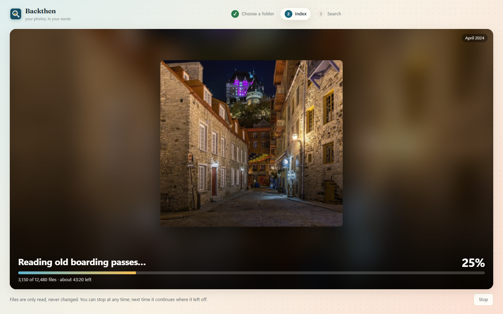
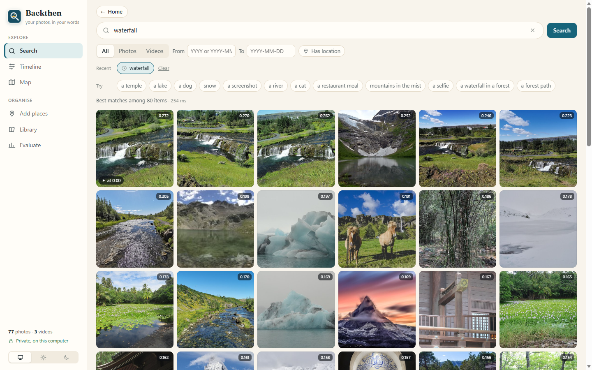
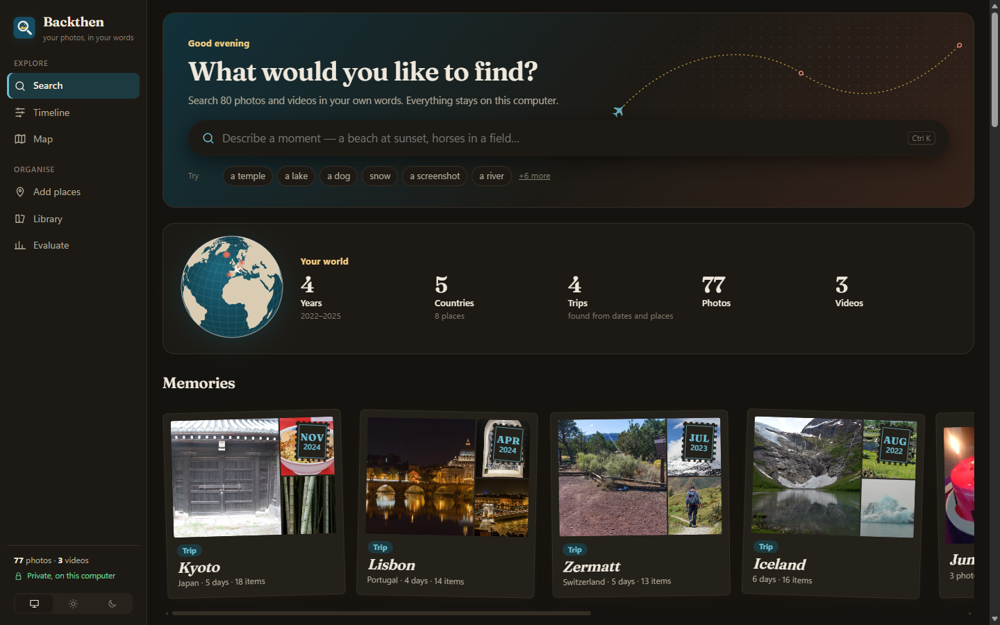
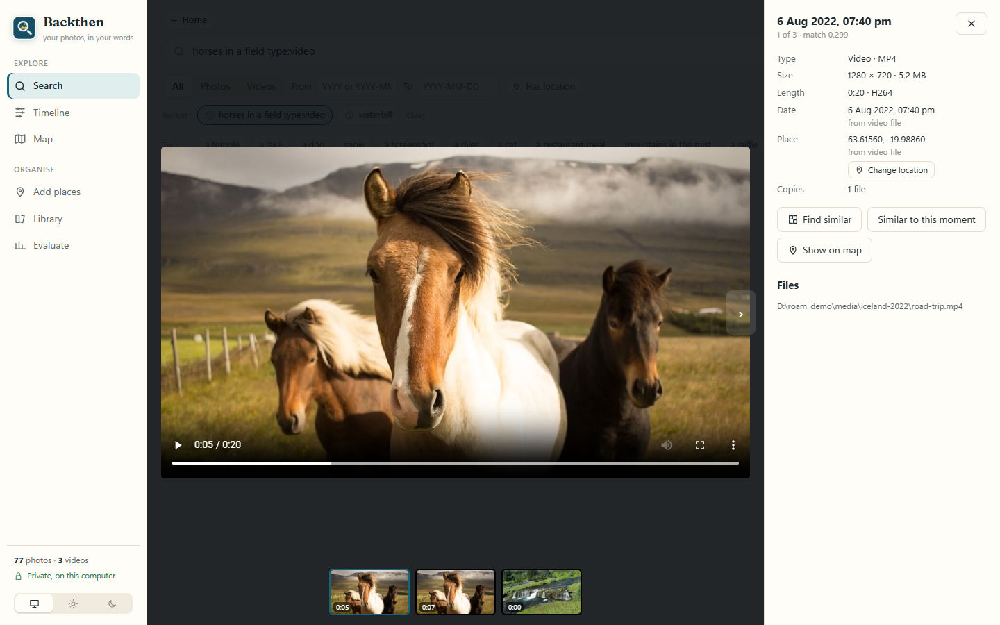
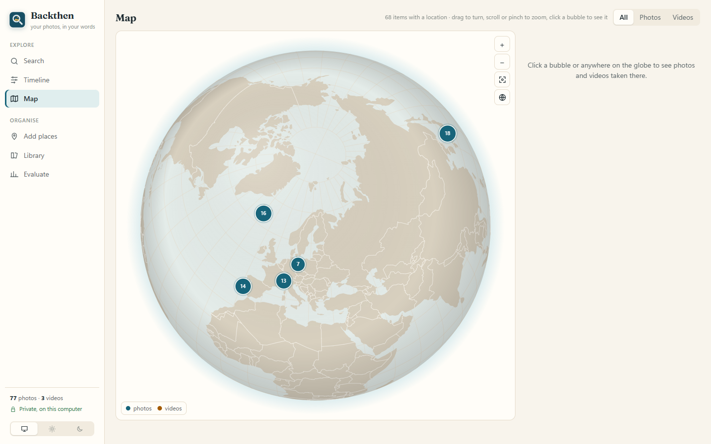
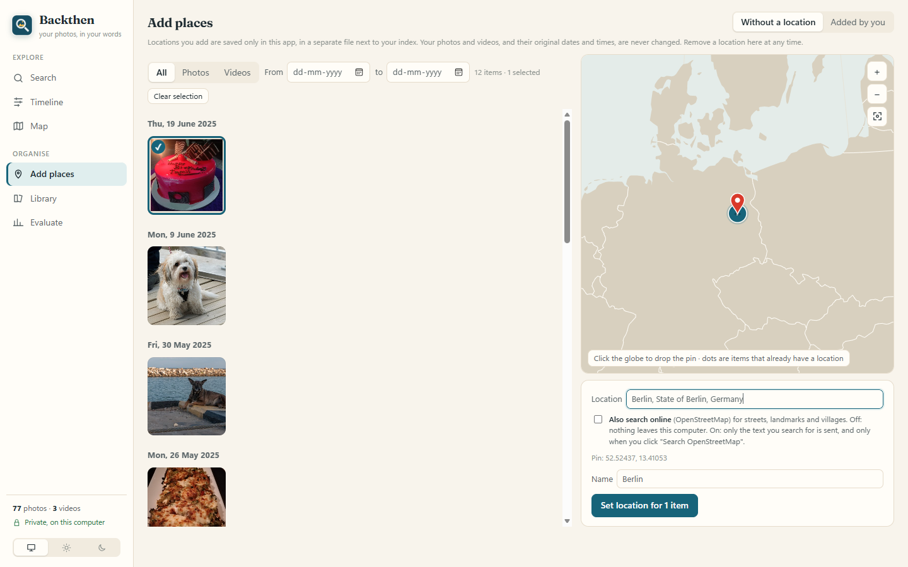
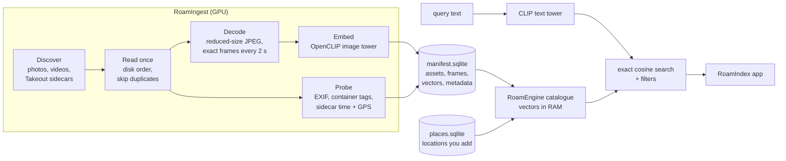

# Backthen

**Search your own photo and video archive in plain words, privately, on a laptop.**
Type "waterfall in the mist" or "birthday cake" and get matching photos and the exact moments inside videos, ranked in about 30 ms. Everything (indexing, search, the map) runs on your machine. No uploads, no cloud, no account.


Backthen is three pieces:

| Component | What it does | Code |
|---|---|---|
| **RoamIngest** | Reads a large mixed archive once, extracts frames, metadata and CLIP embeddings into a versioned SQLite manifest. Resumable, kill-safe, deterministic. | [`packages/roam-ingest`](packages/roam-ingest) |
| **RoamEngine** | Local search engine and HTTP API: natural-language search, similar items, time and place filters, video moments, retrieval evaluation. | [`packages/roam-engine`](packages/roam-engine) |
| **RoamIndex** | The Backthen desktop app (Tauri 2 + React): first-run onboarding, home with trips and Memories, search, viewer, timeline, offline 3D globe, adding places by hand, indexing with a live slideshow. | [`apps/roamindex`](apps/roamindex) |

## Screenshots

All screenshots use a demo library of 77 CC0 photos from Wikimedia Commons, with made-up dates and locations; its three videos are assembled from those photos ([attribution](docs/screenshots/ATTRIBUTION.md), scripts in [`bench/demo`](bench/demo)).

| | |
|---|---|
|  **First run:** a full-screen welcome with a turning globe; choose or drop a folder, the drive type (USB hard drive or internal SSD) is detected for you. |  **Indexing slideshow:** the photos found so far fade past, one travel-nostalgia line per photo ("Collecting postcards…"), with the percentage and time left. |
|  **Search in your own words:** results as you pause typing, recent searches kept on this computer, `Ctrl K` from anywhere. |  **Your world and trips:** trips are found from dates and GPS alone (offline, GeoNames) and shown as postcards; the strip counts years, countries, trips, photos and videos. Light or dark, or follow Windows. |
|  **Video moments:** "horses in a field" finds the clip and opens it at 0:05, where the horses appear; the strip below lists its other best moments. |  **Offline globe:** wheel or pinch to zoom, drag to turn; opens framed on where your pins are. No map tiles are downloaded. |
|  **Timeline:** items per month on a continuous axis; undated items listed separately. |  **Add places:** give photos without GPS a location by name (offline gazetteer of 172k places) or by clicking the globe. Originals and their dates are never modified. |

## How it works



1. **Discover** every photo (JPEG, PNG, WebP, HEIC, GIF, Nikon NEF) and video (MP4, MOV, MKV, WebM, 3GP...) plus Google Takeout `.json` sidecars.
2. **Read each file once.** On a hard drive: one sequential reader, files sorted by their physical position on disk, and byte-identical copies recognised from 128 KiB and linked without reading the rest.
3. **Decode** photos at reduced size (enough for the 224 px model input and thumbnails) and videos with *smart* exact sampling: one frame every 2 s (max 32), seeking past keyframe intervals without a target (66% fewer frames decoded, bit-identical output). HEVC goes to the GPU decoder (NVDEC).
4. **Probe** capture time and GPS from EXIF, video container tags and Takeout sidecars, recording where each value came from.
5. **Embed** each photo and frame with an OpenCLIP image encoder (fp16 on CUDA) in fixed-shape batches, so re-running gives bit-identical vectors.
6. **Write** everything to `manifest.sqlite` (schema v1) in per-file transactions: a run can be killed at any moment and resumed; an unchanged rerun does nothing.

**Search:** the query goes through the matching CLIP text encoder; its vector is compared with every photo and frame vector (one matrix-vector product, exact, no approximate index needed at this scale). A video scores by its best frame and returns its best moments with timestamps. Filters (`type:video`, `year:2019`, `after:2020-05`, `has:gps`, near a point) are masks over the scores.

## Embedding model

Default: **OpenCLIP ViT-B/32, LAION-2B** (`laion2b_s34b_b79k`, 512-d). CLIP embeds images and text in one space, so a text query finds images directly, with no captions or tags needed. Every vector records its `model_id`, so libraries built with different models never mix. `roamingest run --model <arch>/<pretrained>` picks another OpenCLIP model that uses 224 px input and CLIP normalisation.

**Public benchmarks, text to image/video, Recall@1** (the right item ranked first), all run through the unchanged pipeline and `Engine.search` ([details](results/EXP_MODEL_COMPARE.md)):

| Model | Flickr30k 1k | MS-COCO 5k | MSR-VTT 1k-A (video) | Query time, CPU / GPU text encoder |
|---|---|---|---|---|
| ViT-B/32 LAION-2B (default) | 0.662 | 0.394 | 0.327 | 32 / 9 ms |
| ViT-B-16 DFN-2B | 0.691 | 0.436 | 0.314 | 32 / 9 ms |
| ViT-L-14 DataComp-XL | 0.733 | 0.459 | 0.359 | 60 / 9 ms |
| ViT-L-14 DFN-2B | 0.751 | 0.487 | 0.368 | 61 / 9 ms |
| **ViT-H-14 DFN-5B** | **0.797** | **0.527** | **0.384** | 228 / 30 ms |

- The pipeline loses nothing: with the default model it matches plain OpenCLIP on the same files and the published OpenCLIP numbers (Flickr R@1 0.662 vs 0.667 plain vs 0.668 published; COCO 0.394 / 0.394 / 0.393) ([details](results/EXP_PUBLIC_RETRIEVAL.md)).
- Full tables with R@5, R@10, MRR and nDCG@10: [`results/EXP_MODEL_COMPARE.md`](results/EXP_MODEL_COMPARE.md).

## Benchmarks

Measured on a laptop: RTX 3050 Laptop (4 GB), 16 GB RAM, NVMe SSD, archive on a USB hard drive (55–90 MB/s). All reports give aggregate numbers only.

### Ingestion: a real 355 GB personal archive

| | Result |
|---|---|
| Archive | 94,886 files, 354.9 GiB: 61,380 images, 6,132 videos (up to 9.4 GB each), 24,682 Takeout sidecars |
| Indexed | 67,512 media files → 48,569 unique items, 73,815 vectors (44,014 photos, 29,801 video frames) |
| **Wall time, cold, USB hard drive** | **87.1 min** (v0.1: 98.2 min) |
| Bytes read | 288.9 GB; 18,883 duplicate copies (52.6 GB) linked without reading |
| Peak RAM / VRAM | 3.85 GB / 1.12 GB |
| Kill mid-run, then resume | manifest identical to an uninterrupted run |
| Unchanged rerun | 0 files processed |

The run is bound by the hard drive: the reader is busy 90% of the time, the GPU 8% ([bottleneck analysis](results/BOTTLENECK_ARCHIVE355.md)). What got it there:

| Change | Effect | Report |
|---|---|---|
| Smart exact video sampling | −66% frames decoded, bit-identical output | [EXP_SAMPLING](results/EXP_SAMPLING.md) |
| Opt out of Windows power throttling (EcoQoS) | 148.9 → 46.2 s on the same job | [EXP_POWER](results/EXP_POWER.md) |
| HEVC to NVDEC, H.264 on CPU | −32% video decode time | [PHASE1_REPORT](results/PHASE1_REPORT.md) |
| Duplicate skip + disk-order reads | 98.2 → 87.1 min, output identical | [EXP_SPEED_DEDUP_ORDER](results/EXP_SPEED_DEDUP_ORDER.md) |
| Overall vs the first baseline (17 GiB USB folder) | 540 s → 242 s (2.2×) | [PHASE1_REPORT](results/PHASE1_REPORT.md) |

Public benchmarks with the default model: Flickr30k 1,000 photos in 2.5 s, MS-COCO 5,000 photos in 12.6 s, MSR-VTT 1,000 clips in 57 s (SSD).

### Search

| On the 355 GB index (48,569 items, 73,815 vectors) | Result |
|---|---|
| Catalogue load | 1.8 s, 337 MB RAM |
| Query p50 / p95 (CPU text encoder) | 32 / 37 ms: encode 26 ms + rank 6 ms |
| In the app, typing to rendered results | about 85 ms |

Exact search is fast enough at this scale, so there is no approximate index yet ([ADR-009](docs/decisions/ADR-009-exact-search-before-ann.md)).

## Quick start

Requirements: Windows 10/11 (developed and tested there), Python 3.13, an NVIDIA GPU is optional (CPU works, slower). For the desktop app: Node 20+ and Rust (stable).

```bash
python -m venv .venv && .venv\Scripts\activate
pip install -e packages/roam-ingest -e packages/roam-engine

# index a folder (resumable; --storage hdd for a hard drive)
roamingest run "D:\Photos" --out-dir D:\backthen_library --storage ssd

# search from the command line
roamengine search "a waterfall in a forest" --library D:\backthen_library

# or run the desktop app
cd apps/roamindex && npm install && npx tauri dev
```

In the app, **Library → Settings** points it at the library folder and Python, and **Index folder** runs ingestion with a progress bar.

## Privacy

- Indexing, search, thumbnails and the map run locally. The engine listens on `127.0.0.1` only, with a per-launch token ([ADR-010](docs/decisions/ADR-010-engine-as-local-api-sidecar.md)).
- Original files are opened read-only. Locations you add are stored separately (`places.sqlite`) and never written into your photos; dates are never changed.
- Place search is offline (GeoNames). Online search (OpenStreetMap Nominatim) is off by default and, when you enable it, sends only the text you search for, only when you click.
- Console output and reports contain aggregate numbers only: no file names, paths or metadata values.

## Repository layout

```
packages/roam-ingest   ingestion library and CLI (roamingest)
packages/roam-engine   search engine, local API, evaluation (roamengine)
apps/roamindex         desktop app (Tauri 2 + React + TypeScript)
shared/schemas         manifest v1 SQL schema
bench/                 benchmark harness, public-benchmark and demo scripts
results/               benchmark reports (aggregate numbers)
docs/architecture      architecture overview
docs/decisions         architecture decision records (ADR-001..011)
docs/planning          the original problem statement and research plans
```

Tests: `pytest packages/roam-ingest` and `pytest packages/roam-engine` (synthetic data generated at test time).

## Credits

- [OpenCLIP](https://github.com/mlfoundations/open_clip) and the model authors: LAION, Apple DFN, DataComp.
- [GeoNames](https://www.geonames.org/) place data (CC BY 4.0), bundled for offline place search.
- [Natural Earth](https://www.naturalearthdata.com/) via world-atlas for the globe outlines (public domain).
- Demo images and videos: Wikimedia Commons contributors, CC0 ([list](docs/screenshots/ATTRIBUTION.md)).
- Public benchmarks: Flickr30k, MS-COCO, MSR-VTT (used for evaluation only; not redistributed).
